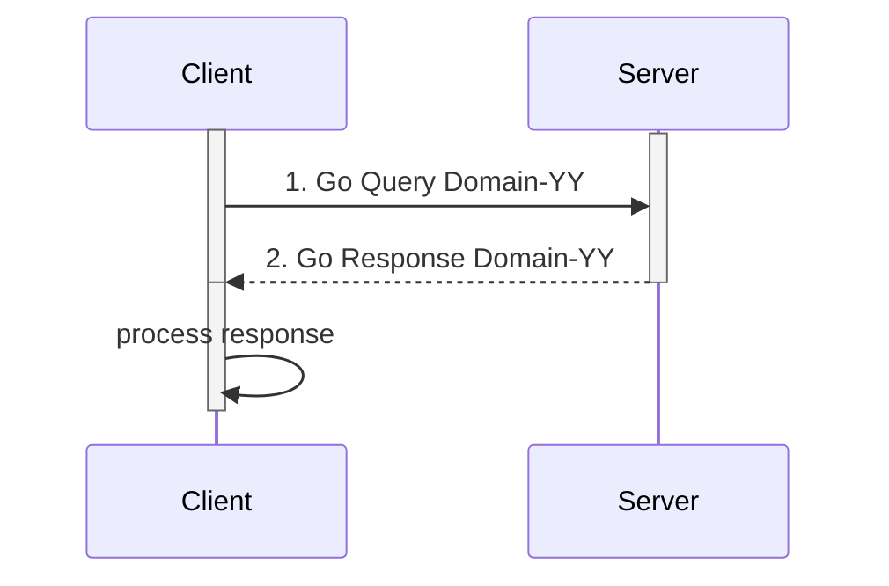

**TODO: Provide an end-user friendly overview of what the profile does for them. Keep it brief (a paragraph or two, up to a page). If extensive detail is needed, it should be included in Section XX.4- Use Cases.**

**TODO: Explicitly state whether this is a Workflow, Transport, or Content Module (or combination) profile. See the IHE Technical Frameworks General Introduction for definitions of these profile types. The IHE Technical Frameworks [General Introduction](https://profiles.ihe.net/GeneralIntro/). **

## 1:XX.1 ToDo Actors, Transactions, and Content Modules

* Actors
  * [Client](#client)
  * [Server](#server)
* Transactions
  * [do domain-Y](domain-YY.html)

Actors and transactions are used to achieve this use-case...

<figure>

<figcaption><strong>Figure 1:X.X.X.X-X: Use Case 1 Process Flow</strong></figcaption>
</figure>
 

This section defines the actors and transactions in this implementation guide.

Figure below shows the actors directly
involved in the ToDo 
Profile and the relevant transactions between them.

<figure>

<figcaption><strong>Figure 1:XX.1-2: ToDo Actor Diagram</strong></figcaption>
</figure>
 

or for Content Profiles use this
<figure>

<figcaption><strong>Figure 1:XX.1-2: ToDo Document Sharing Actor Diagram</strong></figcaption>
</figure>
 

<strong>Table 1:XX.1-1: Profile Acronym Profile - Actors and Transactions</strong>

| Actors  | Transactions  | Initiator or Responder | Optionality     | Reference                                  |
|---------|---------------|------------------------|-----------------|--------------------------------------------|
| Actor A | Transaction 1 |                        | R               | [Domain Acronym TF-2: 3.Y1](./domain-Y1.html) |
|         | Transaction 2 |                        | R               | [Domain Acronym TF-2: 3.Y2](./domain-Y2.html) |
| Actor F | Transaction 1 |                        | R               | [Domain Acronym TF-2: 3.Y1](./domain-Y1.html) |
|         | Transaction 2 |                        | R               | [Domain Acronym TF-2: 3.Y2](./domain-Y2.html) |
| Actor D | Transaction 1 |                        | R               | [Domain Acronym TF-2: 3.Y1](./domain-Y1.html) |
| Actor E | Transaction 2 |                        | R               | [Domain Acronym TF-2: 3.Y2](./domain-Y2.html) |
|         | Transaction 3 |                        | O ( See Note 1) | [Domain Acronym TF-2: 3.Y3](./domain-Y3.html) |
|         | Transaction 4 |                        | O ( See Note 1) | [Domain Acronym TF-2: 3.Y4](./domain-Y4.html) |
| Actor B | Transaction 3 |                        | R               | [Domain Acronym TF-2: 3.Y3](./domain-Y3.html) |
|         | Transaction 4 |                        | O ( See Note 2) | [Domain Acronym TF-2: 3.Y4](./domain-Y4.html) |
{: .grid}

Note 1: *For example, a note could specify that at least one of the
transactions shall be supported by an actor or other variations. For
example: Note: Either Transaction Y3 or Transaction Y4 shall be
implemented for Actor E.*

Note 2: *For example, could specify that Transaction Y4 is required
if Actor B supports XYZ Option, see Section 1:XX.3.X.*

### 1:XX.1.1 Actors
###  Audit Record Repository

> The Audit Record Repository receives event audit reports and stores
> them. It may be part of a federated network of repositories. It is
> expected to have analysis and reporting capabilities, but those
> capabilities are not specified as part of this profile. This profile
> does not specify the capacity of an Audit Record Repository, because
> the variety of deployment needs makes it impractical to set
> requirements for the event report volume or capacity needed.
>
> The Audit Repository shall support:
<ol>
  <li>At least one of the audit transport mechanisms specified in [ITI
    TF-2: 3.20](https://profiles.ihe.net/ITI/TF/Volume2/ITI-20.html)
    (see Table 9.2-1).</li>
  <li>Receipt of at least one of the IHE-specified audit message formats.
    Note that the message format is extensible to include both future
    IHE specifications (e.g., audit requirements for new IHE
    transactions) and private extensions.</li>
  <li>Local security and privacy service protections and user access
    controls.</li>
</ol>

> The Audit Record Repository may ignore or process messages in non-IHE message formats. This may be for backwards compatibility or other reasons.
>
> The Audit Record Repository be grouped with a Secure Node or Secure Application.

> The Audit Record Repository may support search capabilities as defined in ITI TF-2: 3.81 and 3.82.

> Audit Record Repository may support search capabilities as defined in ITI TF-2: 3.81 and[3.82.

### 9.1.1.5 Audit Consumer

> The Audit Consumer queries an Audit Record Repository for syslog and
> ATNA audit records using Syslog metadata and ATNA audit record
> content. Subsequent processing of the query result is not defined in this profile.

##  9.2 ATNA Actor Options

> Options that may be selected for this Integration Profile are listed
> in the Table 9.2-1 along with the actors to which they apply.
> Dependencies between options when applicable are specified in notes.
>
> Note: The "ATX" prefix in option names below marks alternatives for
> audit transport protocol, and the "STX" prefix marks alternatives for
> secure transport protocol, as defined in the Record Audit Event
> \[ITI-20\] transaction.
>
> **Table 9.2-1: ATNA -- Actors and Options**

| Actor                            | Option Name                      | Vol. & Section     |
|----------------------------------|----------------------------------|--------------------|
| Audit Record Repository (Note 4) | Retrieve Audit Message           | ITI TF-1: 9.2.3    |
|                                  | Retrieve Syslog Message          | ITI TF-1: 9.2.4    |
|                                  | ATX: FHIR Feed                   | ITI TF-1: 9.2.7.1  |
|                                  | ATX: TLS Syslog                  | ITI TF-1: 9.2.7.2  |
|                                  | ATX: UDP Syslog                  | ITI TF-1: 9.2.7.3  |
| Audit Consumer                   | Retrieve Audit Message (Note 5)  | ITI TF-1: 9.2.3    |
|                                  | Retrieve Syslog Message (Note 5) | ITI TF-1: 9.2.4    |
| Audit Record Forwarder (Note 4)  | ATX: FHIR Feed                   | ITI TF-1: 9.2.7.1  |
|                                  | ATX: TLS Syslog                  | ITI TF-1: 9.2.7.2  |
|                                  | ATX: UDP Syslog                  | ITI TF-1: 9.2.7.3  |
| "Secure Node (Note 1)            |                                  |                    |
|  (Note 4)"                       | Radiology Audit Trail            | "RAD TF-1: 2.2.1   |
|  RAD TF-3: 5.1"                  |                                  |                    |
|                                  | …                                | …                  |
|                                  | ATX: FHIR Feed                   | ITI TF-1: 9.2.7.1  |
|                                  | ATX: TLS Syslog                  | ITI TF-1: 9.2.7.2  |
|                                  | ATX: UDP Syslog                  | ITI TF-1: 9.2.7.3  |
| "Secure Application (Note 1)     |                                  |                    |
|  (Note 4)"                       | Radiology Audit Trail            | "RAD TF-1: 2.2.1   |
|  RAD TF-3: 5.1"                  |                                  |                    |

>
> Note 4: This actor shall support at least one of the "ATX" Options. If
> a product's IHE Integration Statement does not declare one of these
> options, the reader should assume that the product supports the TLS or
> UDP Syslog Option.
>
> Note 5: The Audit Consumer shall support at least one of the two
> options defined.

###  9.2.3 Retrieve Audit Message Option

> The Retrieve Audit Message Option enables search requests for audit
> records based upon message contents.
>
> An Audit Consumer or Audit Record Repository that supports this option
> shall implement the Retrieve ATNA Audit Event \[ITI-81\] transaction.
>
> The \[ITI-81\] transaction is a RESTful search from an Audit Consumer
> to an Audit Record Repository (ARR) using FHIR resources. The search
> response will reflect the contents of the data storage at the time of
> the search. IHE does not specify the criteria for message selection,
> archival, retention interval, etc. These are set by local policy and
> are often different for different Audit Record Repositories.

### 9.2.4 Retrieve Syslog Message Option

> The Retrieve Syslog Message Option enables search requests for syslog
> messages based upon syslog metadata.
>
> An Audit Consumer or Audit Record Repository that supports this option
> shall implement the Retrieve Syslog Event \[ITI-82\] transaction.
>
> The \[ITI-82\] transaction is a RESTful search operation that searches
> syslog messages of any format or schema. The search request uses the
> syslog metadata only.

### 9.2.7 Audit Transport (ATX) Options

> At least one of these options shall be supported. Many can be
> declared, for which the productmust then be configurable to enable each of the supported Audit Transport Options.

###  9.2.7.1 ATX: FHIR Feed Option

> The ATX: FHIR Feed Option enables sending ATNA audit records using
> RESTful
>
> An Audit Record Repository that supports this option shall
> implement the two RESTful interactions defined in the
> Record Audit Event \[ITI-20\] transaction. See ITI TF-2:
> 3.20.4.2 (Send Audit Resource) and 3.20.4.4 (Send Audit
> Bundle).
>
> A Secure Node, Secure Application or Audit Record Forwarder that
> supports this option shall at least support one of the
> two RESTful interactions defined in the Record Audit
> Event \[ITI-20\] transaction. See ITI TF-2: 3.20.4.2 (Send Audit
> Resource) and 3.20.4.4 (Send Audit
> Bundle).
>
> ### 9.2.7.2 ATX: TLS Syslog Option
>

> **Table 9.3-1: ATNA - Required Actor Groupings**

+--------------+----------------------------+---------+---------------+
| > **ATNA     | > **Actor to be grouped    | >       | > **Content   |
| > Actor**    | > with**                   |  **Refe | > Bindings    |
|              |                            | rence** | > Reference** |
+==============+============================+=========+===============+
| > Audit      | > Consistent Time / Time   | > ITI   | > N/A         |
| > Record     | > Client                   | > TF-1: |               |
| > Repository |                            | > 7     |               |
+--------------+----------------------------+---------+---------------+
|              | > ATNA / Secure Node or    | > ITI   | > N/A         |
|              | > Secure Application       | > TF-1: |               |
|              |                            | > 9     |               |
+--------------+----------------------------+---------+---------------+
| > **[Audit   | > **[ATNA / Secure Node or | >       | > **[N/A]{    |
| >            | > Secure                   |  **[ITI | .underline}** |
|  Consumer]{. | >                          | > TF-1: |               |
| underline}** | Application]{.underline}** | > 9]    |               |
|              |                            | {.under |               |
|              |                            | line}** |               |
+--------------+----------------------------+---------+---------------+
| > ...        |                            |         |               |
+--------------+----------------------------+---------+---------------+

#### 1:XX.1.1.1 Client

The Client queries for blah meeting certain criteria and may retrieve selected blah.

FHIR Capability Statement for [Client](CapabilityStatement-IHE.ToDo.client.html)

#### 1:XX.1.1.2 Server

The Sever processes query request from the Client actor.

FHIR Capability Statement for [Server](CapabilityStatement-IHE.ToDo.server.html)

### 1:XX.1.2 Transaction Descriptions

The transactions in this profile are summarized in the sections below.

#### 1:XX.1.2.1 ToDo do transaction

This transaction is used to **do things**

For more details see the detailed [transaction description](domain-YY.html)

## 1:9.2 ATNA Actor Options

Options that may be selected for this Integration Profile are listed in the Table 9.2-1 along with the actors to which they apply. Dependencies between options when applicable are specified in notes.
Note: The "ATX" prefix in option names below marks alternatives for audit transport protocol, and the "STX" prefix marks alternatives for secure transport protocol, as defined in the Record Audit Event [ITI-20] transaction.

<strong>Table 1:9.2-1: ATNA Actor Options</strong>

**Table 9.2-1: ATNA – Actors and Options**

| Actor                            | Option Name                      | Vol. & Section     |
|----------------------------------|----------------------------------|--------------------|
| Audit Record Repository (Note 4) | Retrieve Audit Message           | ITI TF-1: 9.2.3    |
|                                  | Retrieve Syslog Message          | ITI TF-1: 9.2.4    |
|                                  | ATX: FHIR Feed                   | ITI TF-1: 9.2.7.1  |
|                                  | ATX: TLS Syslog                  | ITI TF-1: 9.2.7.2  |
|                                  | ATX: UDP Syslog                  | ITI TF-1: 9.2.7.3  |
| Audit Consumer                   | Retrieve Audit Message (Note 5)  | ITI TF-1: 9.2.3    |
|                                  | Retrieve Syslog Message (Note 5) | ITI TF-1: 9.2.4    |
| Audit Record Forwarder (Note 4)  | ATX: FHIR Feed                   | ITI TF-1: 9.2.7.1  |
|                                  | ATX: TLS Syslog                  | ITI TF-1: 9.2.7.2  |

{: .grid}
…
Note 4: This actor shall support at least one of the “ATX” Options. If a product’s IHE Integration Statement does not declare one of these options, the reader should assume that the product supports the TLS or UDP Syslog Option.
**Note 5: The Audit Consumer shall support at least one of the two options defined.**

### 1:9.2.3 Retrieve Audit Message Option

The Retrieve Audit Message Option enables search requests for audit records based upon message contents.
An Audit Consumer or Audit Record Repository that supports this option shall implement the Retrieve ATNA Audit Event [ITI-81] transaction.
The [ITI-81] transaction is a RESTful search from an Audit Consumer to an Audit Record Repository (ARR) using FHIR resources. The search response will reflect the contents of the data storage at the time of the search. IHE does not specify the criteria for message selection, archival, retention interval, etc. These are set by local policy and are often different for different Audit Record Repositories.

### 1:9.2.4 Retrieve Syslog Message Option

The Retrieve Syslog Message Option enables search requests for syslog messages based upon syslog metadata.
An Audit Consumer or Audit Record Repository that supports this option shall implement the Retrieve Syslog Event [ITI-82] transaction.
The [ITI-82] transaction is a RESTful search operation that searches syslog messages of any format or schema. The search request uses the syslog metadata only.

### 1:9.2.7 Audit Transport (ATX) Options

At least one of these options shall be supported. Many can be declared, for which the product must then be configurable to enable each of the supported Audit Transport Options.

#### 1: 9.2.7.1 ATX: FHIR Feed Option

**The ATX: FHIR Feed Option enables sending ATNA audit records using RESTful capabilities and FHIR resources.
An Audit Record Repository that supports this option shall implement the two RESTful interactions defined in the Record Audit Event [ITI-20] transaction. See ITI TF-2: 3.20.4.2 (Send Audit Resource) and 3.20.4.4 (Send Audit Bundle).
A Secure Node, Secure Application or Audit Record Forwarder that supports this option shall at least support one of the two RESTful interactions defined in the Record Audit Event [ITI-20] transaction. See ITI TF-2: 3.20.4.2 (Send Audit Resource) and 3.20.4.4 (Send Audit Bundle).**

#### 1: 9.2.7.2 ATX: TLS Syslog Option

...

<strong>Table 1:9.3-1: ATNA - Required Actor Groupings </strong>

**Table 9.3-1: ATNA – ATNA - Required Actor Groupings**

| ATNA Actor              | Actor to be grouped with                 | Reference   | Content Bindings Reference  |
|-------------------------|------------------------------------------|-------------|-----------------------------|
| Audit Record Repository | Consistent Time / Time Client            | ITI TF-1: 7 | N/A                         |
|                         | ATNA / Secure Node or Secure Application | ITI TF-1: 9 | N/A                         |
| Audit Consumer          | ATNA / Secure Node or Secure Application | ITI TF-1: 9 | N/A                         |
| …                       |                                          |             |          

{: .grid}

## 1:XX.3 ToDo Required Actor Groupings

*Describe any requirements for actors in this profile to be grouped
with other actors.*

*This section specifies all REQUIRED Actor Groupings (although
"required" sometimes allows for a selection of one of several). To
SUGGEST other profile groupings or helpful references for other profiles
to consider, use Section XX.6 Cross Profile Considerations. Use Section
X.5 for security profile recommendations.*

An actor from this profile (Column 1) shall implement all of the
required transactions and/or content modules in this profile ***in
addition to*** ***<u>all</u>*** of the requirements for the grouped
actor (Column 2) (Column 3 in alternative 2).

If this is a content profile, and actors from this profile are grouped
with actors from a workflow or transport profile, the Reference column
references any specifications for mapping data from the content module
into data elements from the workflow or transport transactions.

In some cases, required groupings are defined as at least one of an
enumerated set of possible actors; this is designated by merging column
one into a single cell spanning multiple potential grouped actors. Notes
are used to highlight this situation.

Section XX.5 describes some optional groupings that may be of interest
for security considerations and Section XX.6 describes some optional
groupings in other related profiles.

Two alternatives for Table 1:XX.3-1 are presented below.

- If there are no required groupings for any actor in this profile,
    use alternative 1 as a template.
- If an actor in this profile (with no option), has a required
    grouping, use alternative 1.
- If any required grouping is associated with an actor/option
    combination in this profile, use alternative 2.

alternative 1 Table 1:XX.3-1: Profile Name - Required Actor
Groupings

All actors from this profile should be listed in Column 1, even if
none of the actors has a required groupings. If no required grouping
exists, "None" should be indicated in Column 2. If an actor in a content
profile is required to be grouped with an actor in a transport or
workflow profile, it will be listed **with at least one** required
grouping. Do not use "XD\*" as an actor name.

In some cases, required groupings are defined as at least one of an
enumerated set of possible actors; to designate this, create a row for
each potential actor grouping and merge column one to form a single cell
containing the profile actor which should be grouped with at least one
of the actors in the spanned rows. In addition, a note should be
included to explain the enumerated set. See example below showing
Document Consumer needing to be grouped with at least one of XDS.b
Document Consumer, XDR Document Recipient or XDM Portable Media
Importer

The author should pay special consideration to security profiles in
this grouping section. Consideration should be given to Consistent Time
(CT) Client, ATNA Secure Node or Secure Application, as well as other
profiles. For the sake of clarity and completeness, even if this table
begins to become long, a line should be added for each actor for each of
the required grouping for security. Also see the ITI document titled
'Cookbook: Preparing the IHE Profile Security Section' at
<http://ihe.net/Technical_Frameworks/#IT> for a list of suggested IT and
security groupings.

<strong>Table 1:XX.3-1: Actor Groupings</strong>

<table border="1" borderspacing="0" style='border: 1px solid black; border-collapse: collapse'>
<thead>
<tr class="header">
<th>this Profile Acronym Actor</th>
<th>Actor(s) to be grouped with</th>
<th>Reference</th>
<th>Content Bindings Reference</th>
</tr>
</thead>
<tbody>
<tr class="odd">
<td>Actor A</td>
<td>
<em>external Domain Acronym or blank</em>

<em>profile acronym/Actor</em>

<em>e.g., ITI CT / Time Client</em>
</td>
<td>
<em>TF Reference; typically from Vol 1</em>

<em>e.g., ITI-TF-1: 7.1</em>
</td>
<td>--</td>
</tr>
<tr class="even">
<td>Actor B</td>
<td>None</td>
<td>--</td>
<td>--</td>
</tr>
<tr class="odd">
<td>
Actor C

<em>In this example, Actor C shall be grouped with all three actors listed in column 2</em>
</td>
<td>
<em>external Domain Acronym or blank</em>

<em>profile acronym/Actor</em>
</td>
<td>--</td>
<td>See Note 1</td>
</tr>
<tr class="even">
<td></td>
<td><em>external Domain Acronym or blank profile acronym/Actor</em></td>
<td>--</td>
<td>See Note 1</td>
</tr>
<tr class="odd">
<td></td>
<td>
<em>external Domain Acronym or blank</em>

<em>profile acronym/Actor</em>
</td>
<td>--</td>
<td>See Note 1</td>
</tr>
<tr class="even">
<td>
Actor D <em>(See note 1)</em>

<em>In this example, the note is used to indicate that the Actor D shall be grouped with one or more of the two actors of the two actors in column 2.</em>
</td>
<td>
<em>external Domain Acronym or blank</em>

<em>profile acronym/Actor</em>
</td>
<td>--</td>
<td>See Note 1</td>
</tr>
<tr class="odd">
<td></td>
<td>
<em>external Domain Acronym or blank</em>

<em>profile acronym/Actor</em>
</td>
<td>--</td>
<td>See Note 1</td>
</tr>
<tr class="even">
<td>
Actor E

<em>In rare cases, the actor to be grouped with must implement an option. An example is in column 2.)</em>
</td>
<td>
<em>external Domain Acronym or blank</em>

<em>profile acronym Actor</em>

<em>e.g., ITI RFD Form Filler with the Archive Form Option</em>
</td>
<td>
<em>TF Reference to the Option definition; typically from Vol 1</em>

<em>(e.g., ITI TF-1: 17.3.11)</em>
</td>
<td></td>
</tr>
<tr class="odd">
<td><em>e.g., Content Consumer (See Note 1)</em></td>
<td><em>ITI XDS.b / Document Consumer</em></td>
<td><em>ITI TF-1: 10.1</em></td>
<td><em>PCC TF-2:4.1 (See Note 2)</em></td>
</tr>
<tr class="even">
<td></td>
<td><em>ITI XDR / Document Recipient</em></td>
<td><em>ITI TF-1: 15.1</em></td>
<td><em>PCC TF-2:4.1 (See Note 2)</em></td>
</tr>
<tr class="odd">
<td></td>
<td><em>ITI XDM / Portable Media Importer</em></td>
<td><em>ITI TF-1: 16.1</em></td>
<td><em>PCC TF-2:4.1 (See Note 2)</em></td>
</tr>
<tr class="even">
<td><em>e.g., Content Consumer</em></td>
<td><em>ITI CT / Time Client</em></td>
<td><em>ITI TF-1: 7.1</em></td>
<td>--</td>
</tr>
</tbody>
</table>

Note 1: *This is a short note. It may be used to describe situations
where an actor from this profile may be grouped with one of several
other profiles/actors.*

Note 2: *A note could also be used to explain why the grouping is
required, if that is still not clear from the text above.*

alternative 2 Table 1:XX.3-1: this Profile Acronym Profile

- Required Actor Groupings

All actors from this profile should be listed in Column 1. If no
required grouping exists, "None" should be indicated in Column 3.

Guidance on using the "Grouping Condition" column:

- If an actor has no required grouping, Column 2 should contain "--".
    See Actor A below.
- If an actor has a required grouping that is not associated with a
    profile option (i.e., it has no condition), column 2 should contain
    "Required". See Actor B below.
- Sometimes an option requires that an actor in this profile be
    grouped with an actor in another profile. That condition is
    specified in Column 2. See Actor C below.

<strong>Table 1:XX.3-1: Actor Groupings</strong>

<table border="1" borderspacing="0" style='border: 1px solid black; border-collapse: collapse'>
<tbody>
<tr class="odd">
<td>this Profile Acronym Actor</td>
<td>Grouping Condition</td>
<td>Actor(s) to be grouped with</td>
<td>Reference</td>
</tr>
<tr class="even">
<td>Actor A</td>
<td>--</td>
<td>None</td>
<td>--</td>
</tr>
<tr class="odd">
<td>Actor B</td>
<td>Required</td>
<td>
<em>external Domain Acronym or blank profile acronym/Actor</em>

<em>e.g., ITI CT / Time Client</em>
</td>
<td>
<em>TF Reference; typically from Vol 1</em>

<em>(e.g., ITI TF-1: 7.1)</em>
</td>
</tr>
<tr class="even">
<td>Actor C</td>
<td>With the <em>Option name in this profile</em> Option</td>
<td><em>external Domain Acronym or blank profile acronym/Actor</em></td>
<td><em>Where the Option is defined in this profile Section XX.3 z</em></td>
</tr>
<tr class="odd">
<td>
Actor D

<em>if an actor has both required and conditional groupings, list the Required grouping first</em>
</td>
<td>Required</td>
<td><em>external Domain Acronym or blank profile acronym/Actor</em></td>
<td><em>TF Reference; typically from Vol 1</em></td>
</tr>
<tr class="even">
<td></td>
<td>If the <em>Option name in this profile</em> Option is supported.</td>
<td><em>external Domain Acronym or blank profile acronym/Actor</em></td>
<td><em>TF Reference; typically from Vol 1</em></td>
</tr>
<tr class="odd">
<td></td>
<td>If the <em>other Option name in this profile</em> Option is supported.</td>
<td><em>external Domain Acronym or blank profile acronym/Actor</em></td>
<td><em>TF Reference; typically from Vol 1</em></td>
</tr>
<tr class="even">
<td>
Actor E

<em>(In rare cases, the actor to be grouped with must implement an option, an example is in column 3)</em>
</td>
<td>Required</td>
<td>
<em>external Domain Acronym or blank profile acronym/Actor</em> with the <em>option name</em>

<em>e.g. ITI RFD Form Filler with the Archive Form Option</em>
</td>
<td>
<em>TF Reference to the Option definition; typically from Vol 1</em>

<em>(eg ITI TF-1:17.3.11)</em>
</td>
</tr>
</tbody>
</table>

## 1:XX.4 ToDo Overview

This section shows how the transactions/content modules of the profile
are combined to address the use cases.

Use cases are informative, not normative, and "SHALL" language is
not allowed in use cases.

### 1:XX.4.1 Concepts

If needed, this section provides an overview of the concepts that
provide necessary background for understanding the profile. If not
needed, state "Not applicable." For an example of why/how this section
may be needed, please see ITI Cross Enterprise Workflow (XDW).

It may be useful in this section but is not necessary, to provide a
short list of the use cases described below and explain why they are
different.

### 1:9.4.2 Use Cases
> Sections 9.4.2.1, 9.4.2.2, and
> 9.4.2.3 describe three typical process flows for situations in which authorized users, unauthorized
> users, and unauthorized nodes attempt to gain access to protected health information (PHI).
> Sections 9.4.2.4 and 9.4.2.5 describe use cases related to the retrieve capabilities of the Audit Record Repository.

#### 1:9.4.2.4 Clinician Personal History of Study views process flow
A clinician wants to gather the history of studies she has accessed during her clinical activity using different devices (EHR system, WebApp, Mobile device). This information allows the clinician to:
<ul>
  <li>Discover unexpected accesses made to her devices;</li>
  <li>Re-evaluate clinical decisions taken;</li>
  <li>Consolidate on a unique device, a complete picture of complex clinical cases.</li>
</ul>

##### 1:9.4.2.4.1 Clinician Personal History of Study views use-case

Dr. Luisa White usually performs her clinical activity using multiple devices. Mr. Brown is a patient who is home-monitored. Dr. White collects results of home visits using a tablet, and she monthly performs a detailed visit with Mr. Brown in her office. During home visits, Dr. White analyzes tele-monitoring data collected by some devices (scales, blood pressure devices, etc.) and adjusts drugs therapies in accordance with those data. When Dr. White accesses Mr.
Brown’s data via these devices, each access is tracked as an ATNA audit event. Both document views and document creation are logged, tracking the user that performed the transaction (e.g., using an XUA identity assertion).
Monthly visit, Dr. White wants to consolidate within her EHR system the whole history of data analyzed and collected using multiple devices. This process allows Dr. White to keep track of her clinical activities and revaluate clinical decisions made in the past.
To facilitate that, the EHR system can query for audit events related to transactions performed by Dr. White during a specific period.

##### 1:XX.4.2.1.2 simple name Process Flow

Diagram and describe the process flow(s) covered by this profile in
order to satisfy the use cases. Demonstrate how the profile transactions
are combined/sequenced. To provide context and demonstrate how the
profile interacts with other profiles, feel free to include transactions
and events that are "external" to this profile (using appropriate
notation.)

The set of process flows will typically be exemplary, not exhaustive
(i.e., it will address all the use cases, but will not show all possible
combinations of actors, or all possible sequencing of transactions).

If there are detailed behavioral rules that apply to a specific process
flow or multiple process flows, an appendix may be added as needed.

The roles at the top of the swimlane diagram should correspond to
actor names, include the profile acronym:actor name if referencing an
actor from a different profile.

Modify the following "Swimlane Diagram". You can use plantuml or mermaid. see details on [using mermaid in the IG publisher](https://build.fhir.org/ig/FHIR/ig-guidance/diagrams-mermaid.html). Mermaid [user guide online](https://mermaid.js.org/intro/getting-started.html).  Plantuml seems more stable, and does support clickable links on artifacts. Goto [plantuml.com](http://plantuml.com) for an online tool to draft plantuml files.

**Figure 1:XX.4.2.2-1: Basic Process Flow in Profile Acronym Profile**:

If process flow "swimlane" diagrams require additional explanation
to clarify conditional flows, or flow variations need to be described
where alternate systems may be playing different actor roles, document
those conditional flows here.

Delete the material below if this is a workflow or transport
profile. Delete the material above if this profile is a content module
only profile.

**Pre-conditions**:

Very briefly (typically one sentence) describe the conditions or
timing when this content module would be used.

**Main Flow**:

Typically in an enumerated list, describe the clinical workflow
when, where, and how this content module would be used.

**Post-conditions:**

Very briefly (typically one sentence) describe the state of the
clinical scenario after this content module has been created including
examples of potential next steps.

## 1:XX.5 ToDo Security Considerations

See ITI TF-2: [Appendix Z.8 "Mobile Security Considerations"](https://profiles.ihe.net/ITI/TF/Volume2/ch-Z.html#z.8-mobile-security-considerations)

The following is instructions to the editor and this text is not to be included in a publication.
The material initially from [RFC 3552 "Security Considerations Guidelines" July 2003](https://tools.ietf.org/html/rfc3552).

This section should address downstream design considerations, specifically for: Privacy, Security, and Safety. These might need to be individual header sections if they are significant or need to be referenced.

The editor needs to understand Security and Privacy fundamentals.
General [Security and Privacy guidance]({{site.data.fhir.path}}secpriv-module.html) is provided in the FHIR Specification. 
The FHIR core specification should be leveraged where possible to inform the reader of your specification.

IHE FHIR based profiles should reference the [ITI Appendix Z](https://profiles.ihe.net/ITI/TF/Volume2/ch-Z.html) section 8 Mobile Security and Privacy Considerations base when appropriate.

IHE Document Content profiles can reference the security and privacy provided by the Document Sharing infrastructure as directly grouped or possibly to be grouped.

   While it is not a requirement that any given specification or system be
   immune to all forms of attack, it is still necessary for authors of specifications to
   consider as many forms as possible.  Part of the purpose of the
   Security and Privacy Considerations section is to explain what attacks have been
   considered and what countermeasures can be applied to defend against them.

   There should be a clear description of the kinds of threats on the
   described specification.  This should be approached as an
   effort to perform "due diligence" in describing all known or
   foreseeable risks and threats to potential implementers and users.

Authors MUST describe:

- which attacks have been considered and addressed in the specification
- which attacks have been considered but not addressed in the specification
- what could be done in system design, system deployment, or user training

   At least the following forms of attack MUST be considered:
   eavesdropping, replay, message insertion, deletion, modification, and
   man-in-the-middle.  Potential denial of service attacks MUST be
   identified as well.  If the specification incorporates cryptographic
   protection mechanisms, it should be clearly indicated which portions
   of the data are protected and what the protections are (i.e.,
   integrity only, confidentiality, and/or endpoint authentication,
   etc.).  Some indication should also be given to what sorts of attacks
   the cryptographic protection is susceptible.  Data which should be
   held secret (keying material, random seeds, etc.) should be clearly
   labeled.

   If the specification involves authentication, particularly user-host
   authentication, the security of the authentication method MUST be
   clearly specified.  That is, authors MUST document the assumptions
   that the security of this authentication method is predicated upon.

   The threat environment addressed by the Security and Privacy Considerations
   section MUST at a minimum include deployment across the global
   Internet across multiple administrative boundaries without assuming
   that firewalls are in place, even if only to provide justification
   for why such consideration is out of scope for the protocol.  It is
   not acceptable to only discuss threats applicable to LANs and ignore
   the broader threat environment.  In
   some cases, there might be an Applicability Statement discouraging
   use of a technology or protocol in a particular environment.
   Nonetheless, the security issues of broader deployment should be
   discussed in the document.

   There should be a clear description of the residual risk to the user
   or operator of that specification after threat mitigation has been
   deployed.  Such risks might arise from compromise in a related
   specification (e.g., IPsec is useless if key management has been
   compromised), from incorrect implementation, compromise of the
   security technology used for risk reduction (e.g., a cipher with a
   40-bit key), or there might be risks that are not addressed by the
   specification (e.g., denial of service attacks on an
   underlying link protocol).  Particular care should be taken in
   situations where the compromise of a single system would compromise
   an entire protocol.  For instance, in general specification designers
   assume that end-systems are inviolate and don't worry about physical
   attack.  However, in cases (such as a certificate authority) where
   compromise of a single system could lead to widespread compromises,
   it is appropriate to consider systems and physical security as well.

   There should also be some discussion of potential security risks
   arising from potential misapplications of the specification or technology
   described in the specification.  
  
This section also include specific considerations regarding Digital Signatures, Provenance, Audit Logging, and De-Identification.

Where audit logging is specified, a StructureDefinition profile(s) should be included, and Examples of those logs might be included.

## 1:XX.6 ToDo Cross-Profile Considerations

This section is informative, not normative. It is intended to put
this profile in context with other profiles. Any required groupings
should have already been described above. Brief descriptions can go
directly into this section; lengthy descriptions should go into an
appendix. Examples of this material include ITI Cross Community Access
(XCA) Grouping Rules (Section 18.2.3), the Radiology associated profiles
listed at wiki.ihe.net, or ITI Volume 1 Appendix E "Cross Profile
Considerations", and the "See Also" sections Radiology Profile
descriptions on the wiki such as
<http://wiki.ihe.net/index.php/Scheduled_Workflow#See_Also>. If this
section is left blank, add "Not applicable."

Consider using a format such as the following:

other profile acronym - other profile name

A other profile actor name in other profile name might
be grouped with a this profile actor name to describe
benefit/what is accomplished by grouping.
